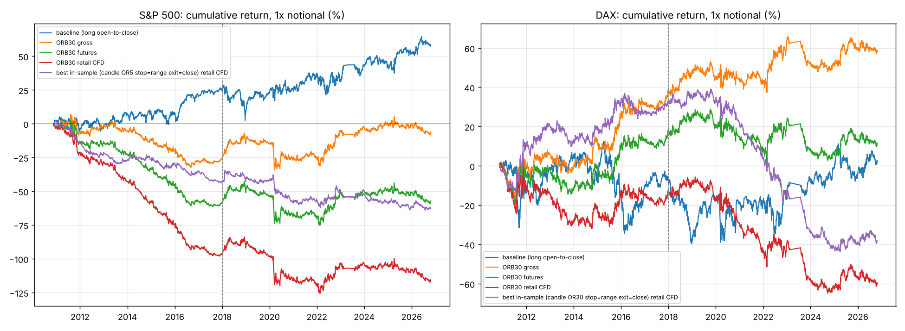

# Opening-range breakout backtest: S&P 500 and DAX

## Conclusions

1. **No configuration is profitable at retail CFD costs** on either index. All 48
   strategy variants lose between 0.8 and 3.7 bp per trade after a realistic
   round-trip spread. Over 16 years that compounds to a 50 to 120 percent loss of
   the traded notional.
2. **S&P 500: no edge even before costs.** Gross expectancy is -0.8 to +1.2 bp
   per trade, and every 95 percent confidence interval includes zero. The index
   drift (long open-to-close every day, +58 percent gross) beats every ORB variant.
3. **DAX: a small gross edge of about 1.5 to 2.3 bp per trade exists**, and it
   just survives futures-level costs (+0.3 to +1.0 bp). But the edge is entirely
   in the long trades, it was stronger before 2018 than after, and the best
   in-sample variant (candle OR30, Sharpe 0.79 on 2010-2017) turned into a loss
   on 2018-2026 (Sharpe -0.39). That is the signature of a decayed or overfitted
   effect, not a tradable one.
4. **Win rates are 26 to 51 percent**, so this family of strategies loses more
   days than it wins by construction. A trader who reports a high win rate with
   an opening-range method is either using a tight profit target (which the
   1R rows show has the worst expectancy) or is not trading this rule.
5. **The 2023 trade count is lower** because the data feed is thinner that year
   (fewer bars per day), so more sessions failed the completeness filter. All
   months are present.

Bottom line: the generic "first candles of the day" rule has no exploitable
edge on these two indices for a retail trader. If a person is profitable with it,
the profit comes from discretion, filters we have not tested, or a run of luck
that 250 trades per year cannot distinguish from skill.

---

Data: histdata.com 1-minute index CFD bars, Nov 2010 to Oct 2026. One trade per day, cash session only. Returns are on 1x index notional (no leverage), so 1 bp = 0.01% of the index level per trade.

Costs (round trip, index points): S&P futures 0.35, S&P retail CFD 0.75; DAX futures 1.0, DAX retail CFD 2.5.

## S&P 500 (SPXUSD)

3719 complete sessions, 2010-11-15 to 2026-10-23.

Baseline, long open-to-close every day, gross: total 57.9%, Sharpe 0.30, mean 1.56 bp/day.

### Full sample, all configurations

| strategy                            |   trades |   gross bp/trade |   gross PF |   gross Sharpe |   futures bp/trade |   futures PF |   futures Sharpe |   retail CFD bp/trade |   retail CFD PF |   retail CFD Sharpe |   win rate |   max DD (CFD) |   P(edge<=0) gross | 95% CI gross bp   |
|:------------------------------------|---------:|-----------------:|-----------:|---------------:|-------------------:|-------------:|-----------------:|----------------------:|----------------:|--------------------:|-----------:|---------------:|-------------------:|:------------------|
| breakout OR5 stop=range exit=close  |     3718 |             1.12 |       1.07 |           0.37 |              -0.26 |         0.98 |            -0.09 |                 -1.84 |            0.90 |               -0.60 |       0.27 |          -0.85 |               0.08 | [-0.4, 2.7]       |
| breakout OR5 stop=range exit=1R     |     3718 |            -0.21 |       0.98 |          -0.13 |              -1.59 |         0.87 |            -0.96 |                 -3.17 |            0.75 |               -1.91 |       0.50 |          -1.18 |               0.68 | [-1.0, 0.6]       |
| breakout OR5 stop=range exit=2R     |     3718 |             0.60 |       1.04 |           0.27 |              -0.78 |         0.95 |            -0.35 |                 -2.36 |            0.85 |               -1.05 |       0.35 |          -0.89 |               0.15 | [-0.5, 1.7]       |
| breakout OR15 stop=range exit=close |     3715 |             0.21 |       1.01 |           0.06 |              -1.17 |         0.94 |            -0.34 |                 -2.75 |            0.87 |               -0.80 |       0.36 |          -1.17 |               0.42 | [-1.5, 2.0]       |
| breakout OR15 stop=range exit=1R    |     3715 |            -0.70 |       0.96 |          -0.29 |              -2.08 |         0.88 |            -0.87 |                 -3.66 |            0.79 |               -1.53 |       0.49 |          -1.40 |               0.87 | [-1.9, 0.5]       |
| breakout OR15 stop=range exit=2R    |     3715 |             0.52 |       1.03 |           0.17 |              -0.86 |         0.96 |            -0.28 |                 -2.44 |            0.88 |               -0.79 |       0.39 |          -1.16 |               0.26 | [-1.0, 2.1]       |
| breakout OR30 stop=range exit=close |     3696 |            -0.18 |       0.99 |          -0.05 |              -1.56 |         0.93 |            -0.43 |                 -3.14 |            0.86 |               -0.86 |       0.42 |          -1.26 |               0.58 | [-2.0, 1.7]       |
| breakout OR30 stop=range exit=1R    |     3696 |            -0.77 |       0.96 |          -0.27 |              -2.15 |         0.89 |            -0.75 |                 -3.73 |            0.82 |               -1.29 |       0.50 |          -1.40 |               0.85 | [-2.2, 0.7]       |
| breakout OR30 stop=range exit=2R    |     3696 |            -0.08 |       1.00 |          -0.02 |              -1.46 |         0.93 |            -0.42 |                 -3.03 |            0.87 |               -0.88 |       0.43 |          -1.28 |               0.53 | [-1.9, 1.7]       |
| breakout OR60 stop=range exit=close |     3605 |             0.74 |       1.04 |           0.20 |              -0.64 |         0.97 |            -0.18 |                 -2.22 |            0.90 |               -0.61 |       0.48 |          -0.99 |               0.23 | [-1.2, 2.7]       |
| breakout OR60 stop=range exit=1R    |     3605 |             0.71 |       1.04 |           0.22 |              -0.67 |         0.97 |            -0.21 |                 -2.25 |            0.89 |               -0.70 |       0.51 |          -0.99 |               0.21 | [-1.0, 2.4]       |
| breakout OR60 stop=range exit=2R    |     3605 |             1.12 |       1.06 |           0.31 |              -0.26 |         0.99 |            -0.07 |                 -1.84 |            0.91 |               -0.51 |       0.48 |          -0.92 |               0.12 | [-0.8, 3.0]       |
| candle OR5 stop=range exit=close    |     3624 |             1.20 |       1.10 |           0.46 |              -0.16 |         0.99 |            -0.06 |                 -1.72 |            0.88 |               -0.66 |       0.19 |          -0.65 |               0.04 | [-0.2, 2.6]       |
| candle OR5 stop=range exit=1R       |     3624 |            -0.17 |       0.98 |          -0.14 |              -1.53 |         0.81 |            -1.30 |                 -3.09 |            0.66 |               -2.63 |       0.50 |          -1.12 |               0.70 | [-0.8, 0.4]       |
| candle OR5 stop=range exit=2R       |     3624 |             0.70 |       1.07 |           0.43 |              -0.66 |         0.94 |            -0.40 |                 -2.22 |            0.81 |               -1.35 |       0.35 |          -0.81 |               0.05 | [-0.1, 1.5]       |
| candle OR15 stop=range exit=close   |     3667 |             0.51 |       1.03 |           0.17 |              -0.86 |         0.95 |            -0.28 |                 -2.43 |            0.86 |               -0.80 |       0.27 |          -0.97 |               0.27 | [-1.0, 2.0]       |
| candle OR15 stop=range exit=1R      |     3667 |             0.02 |       1.00 |           0.01 |              -1.35 |         0.89 |            -0.75 |                 -2.92 |            0.78 |               -1.62 |       0.50 |          -1.07 |               0.49 | [-0.9, 0.9]       |
| candle OR15 stop=range exit=2R      |     3667 |             0.53 |       1.04 |           0.22 |              -0.84 |         0.94 |            -0.35 |                 -2.41 |            0.85 |               -1.01 |       0.35 |          -0.91 |               0.21 | [-0.7, 1.7]       |
| candle OR30 stop=range exit=close   |     3680 |             0.70 |       1.04 |           0.21 |              -0.67 |         0.96 |            -0.20 |                 -2.24 |            0.89 |               -0.68 |       0.33 |          -0.91 |               0.22 | [-1.0, 2.4]       |
| candle OR30 stop=range exit=1R      |     3680 |             0.96 |       1.07 |           0.42 |              -0.41 |         0.97 |            -0.18 |                 -1.98 |            0.87 |               -0.86 |       0.51 |          -0.73 |               0.06 | [-0.2, 2.2]       |
| candle OR30 stop=range exit=2R      |     3680 |             0.20 |       1.01 |           0.07 |              -1.17 |         0.93 |            -0.42 |                 -2.74 |            0.85 |               -0.97 |       0.39 |          -1.10 |               0.40 | [-1.3, 1.7]       |
| candle OR60 stop=range exit=close   |     3684 |             0.56 |       1.03 |           0.16 |              -0.82 |         0.96 |            -0.23 |                 -2.39 |            0.89 |               -0.68 |       0.40 |          -1.14 |               0.27 | [-1.2, 2.4]       |
| candle OR60 stop=range exit=1R      |     3684 |            -0.28 |       0.98 |          -0.10 |              -1.66 |         0.91 |            -0.59 |                 -3.23 |            0.83 |               -1.14 |       0.50 |          -1.32 |               0.66 | [-1.7, 1.2]       |
| candle OR60 stop=range exit=2R      |     3684 |             0.42 |       1.02 |           0.13 |              -0.96 |         0.95 |            -0.29 |                 -2.53 |            0.88 |               -0.77 |       0.42 |          -1.26 |               0.32 | [-1.2, 2.1]       |

### Overfitting check: pick the best 2010-2017, test on 2018-2026 (futures cost)

| strategy                            |   IS bp/trade |   IS Sharpe |   OOS bp/trade |   OOS Sharpe |
|:------------------------------------|--------------:|------------:|---------------:|-------------:|
| candle OR5 stop=range exit=close    |         -0.44 |       -0.19 |           0.04 |         0.02 |
| candle OR5 stop=range exit=2R       |         -0.37 |       -0.24 |          -0.89 |        -0.51 |
| breakout OR5 stop=range exit=close  |         -1.40 |       -0.52 |           0.63 |         0.19 |
| breakout OR60 stop=range exit=1R    |         -1.61 |       -0.55 |           0.07 |         0.02 |
| breakout OR60 stop=range exit=close |         -2.09 |       -0.64 |           0.51 |         0.13 |
| breakout OR5 stop=range exit=2R     |         -1.30 |       -0.65 |          -0.38 |        -0.16 |
| candle OR30 stop=range exit=close   |         -1.95 |       -0.66 |           0.31 |         0.09 |
| candle OR30 stop=range exit=1R      |         -1.39 |       -0.67 |           0.34 |         0.14 |
| candle OR60 stop=range exit=close   |         -2.18 |       -0.69 |           0.24 |         0.06 |
| candle OR15 stop=range exit=close   |         -1.94 |       -0.70 |          -0.03 |        -0.01 |
| breakout OR60 stop=range exit=2R    |         -2.25 |       -0.71 |           1.30 |         0.33 |
| candle OR15 stop=range exit=2R      |         -1.85 |       -0.84 |          -0.07 |        -0.03 |
| breakout OR15 stop=range exit=close |         -3.08 |       -0.99 |           0.33 |         0.09 |
| candle OR60 stop=range exit=2R      |         -3.01 |       -1.03 |           0.62 |         0.17 |
| candle OR60 stop=range exit=1R      |         -2.67 |       -1.06 |          -0.88 |        -0.29 |
| breakout OR30 stop=range exit=close |         -3.61 |       -1.09 |           0.04 |         0.01 |
| candle OR30 stop=range exit=2R      |         -2.74 |       -1.12 |           0.03 |         0.01 |
| breakout OR15 stop=range exit=2R    |         -3.21 |       -1.17 |           0.99 |         0.30 |
| breakout OR5 stop=range exit=1R     |         -1.88 |       -1.26 |          -1.37 |        -0.77 |
| breakout OR30 stop=range exit=2R    |         -3.93 |       -1.28 |           0.48 |         0.13 |
| candle OR15 stop=range exit=1R      |         -2.16 |       -1.29 |          -0.73 |        -0.39 |
| candle OR5 stop=range exit=1R       |         -1.39 |       -1.34 |          -1.63 |        -1.29 |
| breakout OR30 stop=range exit=1R    |         -4.13 |       -1.60 |          -0.60 |        -0.19 |
| breakout OR15 stop=range exit=1R    |         -3.50 |       -1.61 |          -0.97 |        -0.38 |

Best in-sample: **candle OR5 stop=range exit=close**, IS Sharpe -0.19, OOS Sharpe 0.02.

### Year by year: breakout OR30 stop=range exit=close at futures cost

|   year |   trades |   win_rate |   ret_% |   profit_factor |
|-------:|---------:|-----------:|--------:|----------------:|
|   2010 |    21.00 |       0.33 |   -2.38 |            0.52 |
|   2011 |   238.00 |       0.40 |  -10.50 |            0.86 |
|   2012 |   217.00 |       0.40 |   -0.37 |            0.99 |
|   2013 |   215.00 |       0.40 |   -9.74 |            0.77 |
|   2014 |   221.00 |       0.40 |  -10.87 |            0.76 |
|   2015 |   245.00 |       0.39 |  -11.50 |            0.80 |
|   2016 |   245.00 |       0.39 |  -11.77 |            0.76 |
|   2017 |   221.00 |       0.42 |   -1.39 |            0.94 |
|   2018 |   246.00 |       0.40 |    7.59 |            1.14 |
|   2019 |   246.00 |       0.39 |   -2.63 |            0.93 |
|   2020 |   250.00 |       0.40 |  -14.37 |            0.84 |
|   2021 |   249.00 |       0.46 |   -1.08 |            0.98 |
|   2022 |   248.00 |       0.46 |   17.82 |            1.22 |
|   2023 |   139.00 |       0.46 |    1.43 |            1.05 |
|   2024 |   247.00 |       0.40 |    1.00 |            1.03 |
|   2025 |   247.00 |       0.42 |   -2.07 |            0.96 |
|   2026 |   201.00 |       0.44 |   -6.81 |            0.82 |

- long trades only: 1954 trades, -1.55 bp/trade, PF 0.92, Sharpe -0.35

- short trades only: 1742 trades, -1.57 bp/trade, PF 0.93, Sharpe -0.27

## DAX (GRXEUR)

3851 complete sessions, 2010-11-15 to 2026-10-23.

Baseline, long open-to-close every day, gross: total 2.0%, Sharpe 0.01, mean 0.05 bp/day.

### Full sample, all configurations

| strategy                            |   trades |   gross bp/trade |   gross PF |   gross Sharpe |   futures bp/trade |   futures PF |   futures Sharpe |   retail CFD bp/trade |   retail CFD PF |   retail CFD Sharpe |   win rate |   max DD (CFD) |   P(edge<=0) gross | 95% CI gross bp   |
|:------------------------------------|---------:|-----------------:|-----------:|---------------:|-------------------:|-------------:|-----------------:|----------------------:|----------------:|--------------------:|-----------:|---------------:|-------------------:|:------------------|
| breakout OR5 stop=range exit=close  |     3851 |             1.68 |       1.09 |           0.44 |               0.45 |         1.02 |             0.12 |                 -1.41 |            0.93 |               -0.36 |       0.26 |          -0.79 |               0.04 | [-0.3, 3.6]       |
| breakout OR5 stop=range exit=1R     |     3851 |            -0.02 |       1.00 |          -0.01 |              -1.25 |         0.91 |            -0.65 |                 -3.10 |            0.79 |               -1.60 |       0.50 |          -1.26 |               0.52 | [-1.0, 1.0]       |
| breakout OR5 stop=range exit=2R     |     3851 |             0.86 |       1.05 |           0.32 |              -0.38 |         0.98 |            -0.14 |                 -2.23 |            0.88 |               -0.84 |       0.35 |          -0.99 |               0.10 | [-0.5, 2.2]       |
| breakout OR15 stop=range exit=close |     3848 |             1.74 |       1.07 |           0.40 |               0.50 |         1.02 |             0.12 |                 -1.35 |            0.95 |               -0.31 |       0.34 |          -0.66 |               0.05 | [-0.4, 3.9]       |
| breakout OR15 stop=range exit=1R    |     3848 |            -0.36 |       0.98 |          -0.13 |              -1.59 |         0.92 |            -0.58 |                 -3.44 |            0.83 |               -1.25 |       0.49 |          -1.36 |               0.69 | [-1.8, 1.0]       |
| breakout OR15 stop=range exit=2R    |     3848 |             0.79 |       1.04 |           0.22 |              -0.44 |         0.98 |            -0.12 |                 -2.29 |            0.91 |               -0.64 |       0.38 |          -1.04 |               0.18 | [-0.9, 2.5]       |
| breakout OR30 stop=range exit=close |     3836 |             1.53 |       1.06 |           0.34 |               0.30 |         1.01 |             0.07 |                 -1.55 |            0.94 |               -0.35 |       0.39 |          -0.66 |               0.09 | [-0.7, 3.7]       |
| breakout OR30 stop=range exit=1R    |     3836 |             0.29 |       1.01 |           0.09 |              -0.94 |         0.96 |            -0.29 |                 -2.80 |            0.88 |               -0.85 |       0.49 |          -1.18 |               0.36 | [-1.4, 1.9]       |
| breakout OR30 stop=range exit=2R    |     3836 |             1.01 |       1.04 |           0.25 |              -0.22 |         0.99 |            -0.05 |                 -2.08 |            0.92 |               -0.51 |       0.41 |          -0.92 |               0.16 | [-1.1, 3.0]       |
| breakout OR60 stop=range exit=close |     3779 |             1.19 |       1.05 |           0.26 |              -0.04 |         1.00 |            -0.01 |                 -1.90 |            0.93 |               -0.42 |       0.44 |          -0.82 |               0.15 | [-1.1, 3.5]       |
| breakout OR60 stop=range exit=1R    |     3779 |             0.07 |       1.00 |           0.02 |              -1.17 |         0.95 |            -0.31 |                 -3.02 |            0.88 |               -0.81 |       0.49 |          -1.16 |               0.47 | [-1.8, 2.0]       |
| breakout OR60 stop=range exit=2R    |     3779 |             1.17 |       1.05 |           0.27 |              -0.07 |         1.00 |            -0.02 |                 -1.92 |            0.93 |               -0.44 |       0.45 |          -0.86 |               0.15 | [-1.0, 3.4]       |
| candle OR5 stop=range exit=close    |     3820 |             2.07 |       1.15 |           0.62 |               0.84 |         1.06 |             0.25 |                 -1.01 |            0.94 |               -0.30 |       0.18 |          -0.70 |               0.01 | [0.5, 3.8]        |
| candle OR5 stop=range exit=1R       |     3820 |             0.12 |       1.01 |           0.09 |              -1.11 |         0.88 |            -0.83 |                 -2.96 |            0.71 |               -2.20 |       0.49 |          -1.13 |               0.37 | [-0.6, 0.8]       |
| candle OR5 stop=range exit=2R       |     3820 |             0.89 |       1.08 |           0.47 |              -0.35 |         0.97 |            -0.18 |                 -2.20 |            0.83 |               -1.15 |       0.35 |          -0.89 |               0.03 | [-0.1, 1.8]       |
| candle OR15 stop=range exit=close   |     3831 |             2.28 |       1.13 |           0.59 |               1.05 |         1.06 |             0.27 |                 -0.81 |            0.96 |               -0.21 |       0.26 |          -0.70 |               0.01 | [0.4, 4.2]        |
| candle OR15 stop=range exit=1R      |     3831 |             0.64 |       1.05 |           0.31 |              -0.59 |         0.96 |            -0.29 |                 -2.44 |            0.83 |               -1.20 |       0.51 |          -0.99 |               0.11 | [-0.4, 1.6]       |
| candle OR15 stop=range exit=2R      |     3831 |             0.82 |       1.05 |           0.30 |              -0.41 |         0.98 |            -0.15 |                 -2.26 |            0.88 |               -0.83 |       0.36 |          -0.95 |               0.12 | [-0.5, 2.2]       |
| candle OR30 stop=range exit=close   |     3840 |             2.08 |       1.10 |           0.50 |               0.85 |         1.04 |             0.20 |                 -1.00 |            0.96 |               -0.24 |       0.31 |          -0.83 |               0.03 | [-0.0, 4.2]       |
| candle OR30 stop=range exit=1R      |     3840 |             0.10 |       1.01 |           0.04 |              -1.13 |         0.94 |            -0.43 |                 -2.98 |            0.84 |               -1.14 |       0.50 |          -1.15 |               0.43 | [-1.2, 1.4]       |
| candle OR30 stop=range exit=2R      |     3840 |             1.11 |       1.06 |           0.34 |              -0.12 |         0.99 |            -0.04 |                 -1.97 |            0.91 |               -0.60 |       0.38 |          -0.96 |               0.09 | [-0.5, 2.8]       |
| candle OR60 stop=range exit=close   |     3834 |             2.06 |       1.09 |           0.48 |               0.82 |         1.03 |             0.19 |                 -1.03 |            0.96 |               -0.24 |       0.36 |          -0.53 |               0.03 | [-0.1, 4.3]       |
| candle OR60 stop=range exit=1R      |     3834 |             0.22 |       1.01 |           0.07 |              -1.01 |         0.95 |            -0.33 |                 -2.86 |            0.86 |               -0.93 |       0.50 |          -1.11 |               0.39 | [-1.3, 1.7]       |
| candle OR60 stop=range exit=2R      |     3834 |             1.10 |       1.05 |           0.29 |              -0.13 |         0.99 |            -0.04 |                 -1.99 |            0.92 |               -0.52 |       0.40 |          -0.77 |               0.13 | [-0.8, 3.0]       |

### Overfitting check: pick the best 2010-2017, test on 2018-2026 (futures cost)

| strategy                            |   IS bp/trade |   IS Sharpe |   OOS bp/trade |   OOS Sharpe |
|:------------------------------------|--------------:|------------:|---------------:|-------------:|
| candle OR30 stop=range exit=close   |          3.55 |        0.79 |          -1.50 |        -0.39 |
| candle OR15 stop=range exit=close   |          2.79 |        0.66 |          -0.46 |        -0.13 |
| candle OR30 stop=range exit=2R      |          2.10 |        0.61 |          -2.06 |        -0.64 |
| candle OR5 stop=range exit=close    |          2.09 |        0.57 |          -0.25 |        -0.08 |
| breakout OR5 stop=range exit=close  |          1.55 |        0.38 |          -0.52 |        -0.14 |
| candle OR60 stop=range exit=close   |          1.68 |        0.36 |           0.09 |         0.02 |
| candle OR15 stop=range exit=2R      |          0.86 |        0.30 |          -1.51 |        -0.59 |
| breakout OR30 stop=range exit=close |          1.03 |        0.22 |          -0.35 |        -0.08 |
| breakout OR15 stop=range exit=close |          1.01 |        0.22 |           0.07 |         0.02 |
| candle OR60 stop=range exit=2R      |          0.56 |        0.14 |          -0.74 |        -0.20 |
| breakout OR30 stop=range exit=2R    |          0.51 |        0.12 |          -0.86 |        -0.22 |
| breakout OR15 stop=range exit=2R    |          0.43 |        0.12 |          -1.20 |        -0.35 |
| breakout OR30 stop=range exit=1R    |          0.19 |        0.05 |          -1.93 |        -0.61 |
| breakout OR60 stop=range exit=2R    |         -0.01 |       -0.00 |          -0.13 |        -0.03 |
| breakout OR5 stop=range exit=2R     |         -0.05 |       -0.02 |          -0.67 |        -0.25 |
| candle OR15 stop=range exit=1R      |         -0.07 |       -0.03 |          -1.05 |        -0.53 |
| candle OR5 stop=range exit=2R       |         -0.07 |       -0.04 |          -0.59 |        -0.30 |
| breakout OR60 stop=range exit=close |         -0.18 |       -0.04 |           0.08 |         0.02 |
| candle OR60 stop=range exit=1R      |         -0.20 |       -0.06 |          -1.72 |        -0.58 |
| candle OR30 stop=range exit=1R      |         -0.27 |       -0.10 |          -1.87 |        -0.73 |
| breakout OR60 stop=range exit=1R    |         -0.93 |       -0.23 |          -1.38 |        -0.39 |
| breakout OR15 stop=range exit=1R    |         -0.97 |       -0.34 |          -2.13 |        -0.80 |
| candle OR5 stop=range exit=1R       |         -0.50 |       -0.39 |          -1.64 |        -1.19 |
| breakout OR5 stop=range exit=1R     |         -0.88 |       -0.46 |          -1.57 |        -0.80 |

Best in-sample: **candle OR30 stop=range exit=close**, IS Sharpe 0.79, OOS Sharpe -0.39.

### Year by year: breakout OR30 stop=range exit=close at futures cost

|   year |   trades |   win_rate |   ret_% |   profit_factor |
|-------:|---------:|-----------:|--------:|----------------:|
|   2010 |    32.00 |       0.41 |   -0.48 |            0.93 |
|   2011 |   255.00 |       0.32 |   -5.48 |            0.94 |
|   2012 |   251.00 |       0.34 |    3.89 |            1.06 |
|   2013 |   251.00 |       0.35 |  -10.44 |            0.82 |
|   2014 |   250.00 |       0.41 |   12.10 |            1.22 |
|   2015 |   251.00 |       0.41 |   11.27 |            1.15 |
|   2016 |   253.00 |       0.40 |    1.68 |            1.02 |
|   2017 |   245.00 |       0.39 |    5.98 |            1.16 |
|   2018 |   249.00 |       0.38 |    7.28 |            1.13 |
|   2019 |   252.00 |       0.40 |   -5.48 |            0.90 |
|   2020 |   240.00 |       0.37 |   -5.33 |            0.94 |
|   2021 |   207.00 |       0.41 |   -6.03 |            0.87 |
|   2022 |   252.00 |       0.41 |   13.68 |            1.16 |
|   2023 |   129.00 |       0.29 |  -14.55 |            0.58 |
|   2024 |   255.00 |       0.39 |   -2.14 |            0.95 |
|   2025 |   255.00 |       0.40 |    7.69 |            1.14 |
|   2026 |   209.00 |       0.40 |   -2.20 |            0.95 |

- long trades only: 1903 trades, 1.38 bp/trade, PF 1.06, Sharpe 0.23

- short trades only: 1933 trades, -0.77 bp/trade, PF 0.97, Sharpe -0.12

